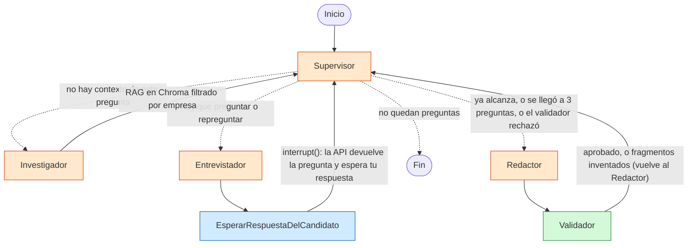

# Proyecto final · Entrevistador de postulaciones

**En una frase:** una API que te **entrevista** sobre las preguntas largas de un formulario de postulación ("¿Por qué esta
empresa?") y arma el primer borrador **solo con tus propias frases**, nunca con texto inventado por el LLM.

**Por qué existe:** cada vez más empresas (por ejemplo, la guía para candidatos de Anthropic) prohíben que la IA escriba
el primer borrador. Pero arrancar desde una hoja en blanco cuesta. Este sistema hace lo que haría un buen entrevistador:
pregunta, repregunta sobre lo que dijiste y después ordena tus palabras. El LLM **elige y ordena**; el código **verifica**
que cada frase del borrador esté literalmente en la transcripción.

**Para un ingeniero senior, en 5 líneas:** grafo de LangGraph con un **Supervisor** que delega en 4 especialistas
(Investigador con RAG, Entrevistador, Redactor y un Validador de código). Cada nodo recibe **solo las claves del estado
que necesita** (`input_schema` por nodo). La entrevista se pausa con `interrupt()` en cada pregunta y el estado vive en
**Redis** (checkpointer), así que sobrevive a un reinicio del servidor. Todo es `async`, todas las fronteras están
validadas con **Pydantic** y cada ejecución se traza en **LangSmith**.

## Diagrama del grafo de agentes



Naranja = usa LLM · Verde = solo código · Azul = pausa para el humano.

## Qué ve y qué escribe cada nodo (aislamiento del estado)

El estado compartido es como un **cuaderno de la entrevista**. Cada nodo recibe una "vista" con solo las páginas que
necesita (`VistaDelRedactor`, `VistaDelEntrevistador`… en `app/grafo/estado.py`) y escribe solo su propia clave.

| Nodo | Función | Lee | Escribe |
|---|---|---|---|
| Supervisor | `decidir_el_siguiente_paso_de_la_entrevista` | preguntas, transcripción, contextos, borradores, errores | `siguiente_paso`, `numero_de_pregunta_actual` |
| Investigador (agente con tool) | `preparar_contexto_del_puesto_para_la_pregunta` | empresa, puesto, pregunta actual | `contextos_del_puesto` |
| Entrevistador | `formular_la_siguiente_pregunta_al_candidato` | pregunta, contexto, transcripción **+ perfil del candidato** (lo lee del disco, nunca pasa por el estado) | `transcripcion` (su pregunta) |
| EsperarRespuestaDelCandidato | `pausar_hasta_recibir_la_respuesta` | última pregunta | `transcripcion` (tu respuesta) |
| Redactor | `armar_borrador_con_las_frases_del_candidato` | **solo tus respuestas** y los errores del validador | `borradores_propuestos` |
| Validador (código) | `descartar_frases_que_no_estan_en_la_transcripcion` | borrador + tus respuestas | `borradores_aprobados` o `errores_de_validacion` |

**Por qué importa:** el Redactor **no puede** copiar de tu perfil porque nunca lo recibe. Es como un examen: el
entrevistador puede tener apuntes, el redactor solo tiene tu hoja de respuestas. Y el Validador lo comprueba igual:
**dos candados**, el aislamiento y el validador.

## Decisiones de arquitectura

| Decisión | Por qué | Alternativa descartada |
|---|---|---|
| Supervisor con **reglas de código primero** y LLM solo para "¿alcanza o repregunto?" | Lo determinista (límites, orden) no se le pregunta a un LLM: es más barato y no falla | Que el LLM decida todo (más llamadas, más errores) |
| Límite de 3 preguntas del entrevistador por pregunta y 2 intentos del redactor, **en código** | Un prompt se puede ignorar, un `if` no | Pedirlo en el prompt |
| Validador **sin LLM** (comparación literal normalizada) | La regla "solo tus frases" tiene que ser verificable, no opinable | LLM-as-judge |
| Registros que solo crecen (`operator.add`) con `numero_de_pregunta` | Se guarda toda la historia y no hay que "limpiar" el estado al cambiar de pregunta | Pisar las claves en cada pregunta |
| RAG como **tool del Investigador** (`create_agent`) | Así lo pide la integración del curso: el agente decide qué buscar | Meter todos los documentos en el prompt |
| **Chroma local + metadatos** (`empresa`, `tipo_de_documento`, `fuente`) | Sin keys ni nube; el filtro por `empresa` evita mezclar documentos de dos empresas | Pinecone (pre-entrega 4): no hace falta para pocos documentos |
| Embeddings locales multilingües en CPU | Gratis y buenos en español | Embeddings pagos |
| `AsyncRedisSaver` como checkpointer | La entrevista sobrevive a reinicios; es la pieza de la pre-entrega 7 | `MemorySaver` (se pierde al reiniciar) |
| Pedido HTTP que espera al grafo (sin cola de trabajos) | Una entrevista es un ida y vuelta: cada respuesta necesita la siguiente pregunta. Menos piezas | Cola + worker de la pre-entrega 7 (sobreingeniería acá) |
| Proveedor y modelos solo por `.env` (`PROVEEDOR_LLM`, `MODELO_PRINCIPAL`, `MODELO_DE_RESPALDO`) + `with_fallbacks` | Cambiar Gemini/OpenAI/Anthropic sin tocar código | Nombres de modelo escritos en el código |
| Datos **ficticios** en el repo; perfil real en `data_privada/` (gitignored) vía `RUTA_DEL_PERFIL_DEL_CANDIDATO` | Repo público y el plan gratis de Gemini puede usar lo que se envía | Subir datos reales |

## Cómo se cumple la consigna

| Consigna | Dónde |
|---|---|
| Integración de los Módulos 6 y 7 en una estructura unificada | Supervisor + especialistas + validador (M6), FastAPI + Redis + LangSmith + human-in-the-loop (M7), RAG (M3/M4) como tool, cliente intercambiable (M1) y cadenas LCEL con Pydantic (M2). Capas separadas en `app/` |
| Todo async | Endpoints `async def`, nodos `async def`, `ainvoke` en LLM y agente, `asimilarity_search` en Chroma, `AsyncRedisSaver`, `httpx.AsyncClient` en las pruebas. Ningún `requests` |
| Checkpointer persistente | `AsyncRedisSaver` en `app/api/principal.py`; ver la prueba de reinicio más abajo |
| Pydantic en API y tools | `app/api/esquemas.py` (entradas y salidas de la API), `app/contratos_de_datos.py` (args de la tool, salida de la tool, salidas estructuradas de cada agente, registros del estado) |
| 5 pruebas con trazas | `probar_5_entrevistas.py` → `evidencia_de_las_5_pruebas.json` y `salida_de_las_5_pruebas.txt`; capturas en `screenshots/` |
| README con diagrama | Este archivo |
| Un solo comando | `./run.sh` |

## Cómo levantarlo

Requisitos: Python 3.12 (declarado en `pyproject.toml` y `.python-version`), [uv](https://docs.astral.sh/uv/) y
Docker **o** Redis 8+ (con `brew install redis` alcanza).

```bash
# desde la raíz del repo, una sola vez:
cp .env.example .env          # completar GOOGLE_API_KEY (u OPENAI/ANTHROPIC) y LANGSMITH_API_KEY

# un solo comando: levanta Redis, instala dependencias, indexa los documentos y arranca la API
./proyecto-final/codigo/run.sh
```

La documentación interactiva queda en **http://localhost:8000/docs**. La primera vez descarga el modelo de embeddings (~470 MB).

### Usar la API

```bash
curl -X POST localhost:8000/entrevistas -H 'Content-Type: application/json' -d '{
  "empresa": "nimbus-edu", "puesto": "Learning Engineer",
  "preguntas_del_formulario": ["¿Por qué querés trabajar en Nimbus Edu?"]}'
# -> {"identificador_de_la_entrevista": "...", "estado": "esperando_respuesta", "pregunta_pendiente": "..."}

curl -X POST localhost:8000/entrevistas/<id>/respuestas -H 'Content-Type: application/json' -d '{"texto": "Porque..."}'
# -> la siguiente pregunta, o "terminada" con los borradores_aprobados

curl localhost:8000/entrevistas/<id>    # transcripción completa y borradores
```

| Método | Ruta | Qué hace |
|---|---|---|
| POST | `/entrevistas` | Crea la entrevista y devuelve la primera pregunta |
| POST | `/entrevistas/{id}/respuestas` | Envía tu respuesta; devuelve la siguiente pregunta o el borrador (409 si no espera respuesta) |
| GET | `/entrevistas/{id}` | Estado, transcripción y borradores (404 si no existe) |
| GET | `/salud` | Chequeo de vida |

### Las 5 pruebas

Con la API levantada, en otra terminal: `cd proyecto-final/codigo && uv run python probar_5_entrevistas.py`

| # | Qué demuestra |
|---|---|
| 1 | Flujo completo con respuestas buenas |
| 2 | Respuestas vagas: el Entrevistador repregunta citando tus palabras |
| 3 | Otra empresa: el RAG filtra por el metadato `empresa` |
| 4 | Pregunta técnica |
| 5 | Dos preguntas en una entrevista: el Supervisor avanza y el Investigador vuelve a buscar |

### Prueba de persistencia (reinicio del servidor)

1. `POST /entrevistas` y responder una pregunta.
2. Cortar la API (Ctrl+C) y volver a correr `./run.sh`.
3. `GET /entrevistas/<id>`: la transcripción sigue ahí y se puede seguir respondiendo, porque el estado está en Redis.

## Observabilidad

Cada pedido se traza en LangSmith (proyecto de `LANGSMITH_PROJECT`) con el `thread_id` de la entrevista como metadato:
se ve el árbol Supervisor → Investigador → tool de RAG → Entrevistador, con tokens, latencia y costo por nodo.

Capturas en [`screenshots/`](screenshots/).

## Estructura

```
proyecto-final/codigo/
├── app/
│   ├── api/            # principal.py (FastAPI) y esquemas.py (Pydantic de entrada y salida)
│   ├── agentes/        # supervisor, investigador, entrevistador, candidato (interrupt), redactor, validador
│   ├── grafo/          # estado.py (estado + vistas por nodo) y construccion.py (el grafo)
│   ├── rag/            # ingesta.py y busqueda.py (Chroma con metadatos)
│   ├── contratos_de_datos.py, configuracion.py, proveedor_de_modelos.py, observabilidad.py
├── data/               # perfil_ficticio.md y documentos_del_puesto/<empresa>/*.md (todo ficticio)
├── screenshots/        # trazas de LangSmith
├── probar_5_entrevistas.py
├── run.sh, docker-compose.yml
```

## Límites conocidos (y lo que sigue)

- El validador compara texto literal: si el Redactor cambia una coma de lugar, ese fragmento se descarta. Es a propósito: preferimos perder una frase a inventar una.
- La embedding y la búsqueda de Chroma corren en un hilo (`asimilarity_search`): no bloquean el event loop, pero Chroma local no tiene cliente async nativo.
- Siguiente paso: voz (notas de voz transcriptas) y una etapa de pulido **después** de que el candidato revise el borrador.
